# Proposal Tugas I — Aplikasi Web Pencatat Pengeluaran Berbantuan Generative AI

# 1. Pendahuluan

## 1.1 Latar Belakang

Perkembangan *Generative Artificial Intelligence* (AI) telah mengubah cara pengembang perangkat lunak bekerja. Alat seperti ChatGPT, Google Gemini, GitHub Copilot, dan Claude kini dapat membantu programmer memahami konsep, menghasilkan potongan kode, menemukan kesalahan, serta memberikan rekomendasi perbaikan. Kemudahan ini menawarkan percepatan yang signifikan, terutama pada tahap *boilerplate* — penulisan struktur awal, *event listener*, dan penanganan data — yang biasanya memakan waktu.

Namun, penggunaan AI dalam pemrograman tidak serta-merta menghilangkan peran manusia. Output AI tetap perlu dievaluasi: apakah sesuai instruksi, apakah aman terhadap kondisi tepi (*edge cases*), dan apakah konsisten dengan kebutuhan pengguna. Kualitas akhir aplikasi tetap menjadi tanggung jawab pengembang, bukan AI. Karena itu, tugas ini tidak hanya menilai hasil program, tetapi juga proses berpikir kritis dalam memberi instruksi kepada AI, mengevaluasi output, mengidentifikasi bug, dan menjelaskan keputusan perbaikan.

Aplikasi **Pencatat Pengeluaran** (*Expense Tracker*) dipilih sebagai studi kasus karena cakupannya kecil namun mencakup siklus CRUD (*Create, Read, Update, Delete*), pengolahan data numerik, dan persistensi data. Berbeda dengan aplikasi daftar tugas yang hanya mengolah teks dan status, aplikasi pengeluaran melibatkan **angka (nominal uang)** dan **input teks bebas dari pengguna**. Dua hal ini terbukti menjadi sumber bug yang realistis dan menarik untuk dianalisis, yaitu kesalahan tipe data dan celah keamanan XSS.

## 1.2 Tujuan

1. Mengembangkan aplikasi web Pencatat Pengeluaran sederhana menggunakan HTML, CSS, dan JavaScript vanilla tanpa framework dan tanpa backend.
2. Mendokumentasikan proses pemberian instruksi kepada Generative AI, evaluasi output, identifikasi bug, dan perbaikan yang dilakukan.
3. Menunjukkan bahwa penggunaan AI dalam pemrograman tetap membutuhkan verifikasi teknis dan tanggung jawab manusia terhadap hasil akhir.

## 1.3 Ruang Lingkup

Aplikasi berjalan sepenuhnya di sisi klien (*client-side*), tanpa backend dan tanpa database server. Data disimpan di `localStorage` browser. Fitur yang disediakan: tambah pengeluaran (deskripsi, nominal, kategori), tampilkan daftar, hapus pengeluaran individual, filter berdasarkan kategori (Semua/Makanan/Transportasi/Belanja/Lainnya), total pengeluaran sesuai filter, hapus semua pengeluaran dengan konfirmasi, dan penanganan data `localStorage` yang rusak.

Repositori proyek: `https://github.com/<username>/pengeluaran-app-ai-assistant` (dosen dan asisten diberi akses sesuai ketentuan tugas).

# 2. Deskripsi Aplikasi

## 2.1 Fitur

| **Fitur** | **Deskripsi** |
|---|---|
| Tambah pengeluaran | Form berisi deskripsi, nominal (Rp), dan kategori; divalidasi sebelum disimpan |
| Daftar pengeluaran | Setiap item menampilkan deskripsi, kategori, dan nominal terformat rupiah |
| Hapus pengeluaran | Tombol Hapus per baris; menghapus berdasarkan ID unik |
| Filter kategori | Tombol Semua / Makanan / Transportasi / Belanja / Lainnya |
| Total pengeluaran | Menjumlahkan nominal item yang sedang tampil, plus jumlah item |
| Hapus semua | Tombol massal dengan konfirmasi yang menyebut jumlah dan total nominal |
| Empty state | Pesan informatif saat daftar (atau kategori) kosong |
| Persistensi | Data disimpan di `localStorage`, bertahan setelah refresh |
| Penanganan data korup | Validasi sintaks JSON, bentuk array, dan bentuk tiap item |
| Validasi form | Pesan kesalahan untuk deskripsi kosong dan nominal tidak valid |

## 2.2 Teknologi

- **HTML5** — struktur halaman
- **CSS3** — tampilan dan tata letak
- **JavaScript (ES6)** — logika aplikasi (tanpa framework, tanpa library)
- **localStorage** — persistensi data di sisi klien
- **Git & GitHub** — *version control* dan hosting repositori
- **Generative AI (Claude)** — asisten pemrograman

## 2.3 Struktur File

```text
pengeluaran-app-ai-assistant/
├── index.html          # struktur halaman (versi final)
├── style.css           # tampilan
├── app.js              # logika aplikasi (versi final, bug diperbaiki)
├── index-buggy.html    # halaman demo versi berbug
├── app.buggy.js        # logika versi berbug (output AI Iterasi 2)
├── prompt-log.md       # catatan prompt, evaluasi, bug, perbaikan
├── proposal.md         # dokumen proposal ini
├── proposal.pdf        # versi PDF untuk submission
├── README.md           # deskripsi singkat repositori
└── screenshots/
    ├── prompts/        # screenshot prompt & output AI
    ├── bugs/           # screenshot bug & perbaikan
    └── testing/        # screenshot pengujian end-to-end
```

Versi berbug (`app.buggy.js`) sengaja dipertahankan di repositori agar setiap bug dapat direproduksi oleh dosen dan asisten: cukup membuka `index-buggy.html` untuk melihat bug, dan `index.html` untuk melihat hasil perbaikan.

## 2.4 Alur Aplikasi

1. Halaman dimuat, `loadExpenses()` membaca `localStorage`.
    - Jika kosong: inisialisasi array kosong.
    - Jika valid: muat ke array `expenses` (hanya item yang bentuknya benar).
    - Jika korup (bukan JSON, bukan array): `try/catch` menangkap error, data rusak dihapus, array diinisialisasi kosong.
2. `renderExpenses()` dipanggil: memfilter data sesuai kategori aktif, membangun elemen `<li>` secara dinamis, lalu memperbarui total, jumlah item, dan status tombol hapus-semua.
3. Interaksi pengguna (tambah, hapus, filter, hapus semua) mengubah *state* `expenses`, lalu `saveExpenses()` menyimpan ke `localStorage` dan `renderExpenses()` dipanggil ulang.
4. Seluruh perubahan UI mengalir dari satu titik (`renderExpenses()`) sehingga semua elemen yang bergantung pada *state* selalu konsisten.

# 3. Proses Penggunaan Generative AI

Proses pengembangan dilakukan melalui **tiga iterasi** dengan AI. Pada iterasi 2, kode yang dihasilkan AI sengaja dijalankan apa adanya (tanpa perbaikan) untuk menguji seberapa kuat kode tersebut menghadapi kondisi tepi. Hasilnya, ditemukan **empat bug** yang kemudian diperbaiki pada iterasi 3. Seluruh prompt dan output dicatat di `prompt-log.md`.

## 3.1 Iterasi 1 — Rancangan Awal

Prompt pertama meminta AI memberikan **rancangan struktur file** untuk aplikasi Pencatat Pengeluaran dengan 7 fitur wajib, tanpa framework, dan tanpa backend. Prompt sengaja tidak meminta kode lengkap agar dapat menilai apakah AI memahami batasan tugas.

Prompt dan output iterasi ini tersimpan di `screenshots/prompts/01-iterasi1-prompt.png` dan `02-iterasi1-output.png`.

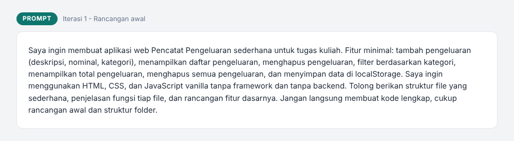

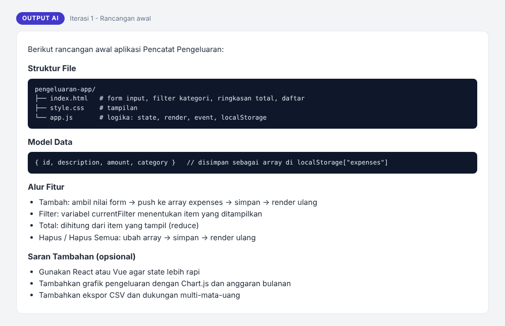

**Evaluasi.** AI menyarankan struktur 3 file (`index.html`, `style.css`, `app.js`), model data `{id, description, amount, category}`, dan `localStorage` sebagai media penyimpanan — sesuai instruksi. Namun AI juga menyarankan penggunaan React/Vue, grafik Chart.js, anggaran bulanan, ekspor CSV, dan multi-mata-uang yang **tidak diminta** dan tidak diperlukan untuk tugas sederhana.

**Keputusan.** Saran tambahan **tidak diadopsi** karena menambah kompleksitas tanpa nilai tambah. Aplikasi tetap menggunakan HTML/CSS/JS vanilla dan fitur dibatasi pada kebutuhan minimal.

## 3.2 Iterasi 2 — Implementasi Kode

Prompt kedua meminta **kode lengkap** untuk ketiga file, dengan penekanan pada penanganan `localStorage` kosong, komentar singkat, dan pemisahan file yang rapi. Seluruh tampilan diminta dirender dari satu fungsi `renderExpenses()`.

- `screenshots/prompts/03-iterasi2-prompt.png` — prompt kedua
- `screenshots/prompts/04-iterasi2-output.png` sampai `06-iterasi2-output.png` — output AI (kode lengkap, di-screenshot dalam tiga bagian karena panjang)

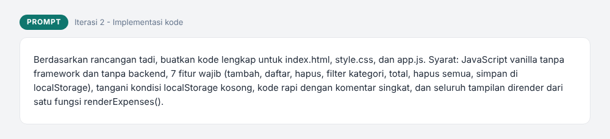

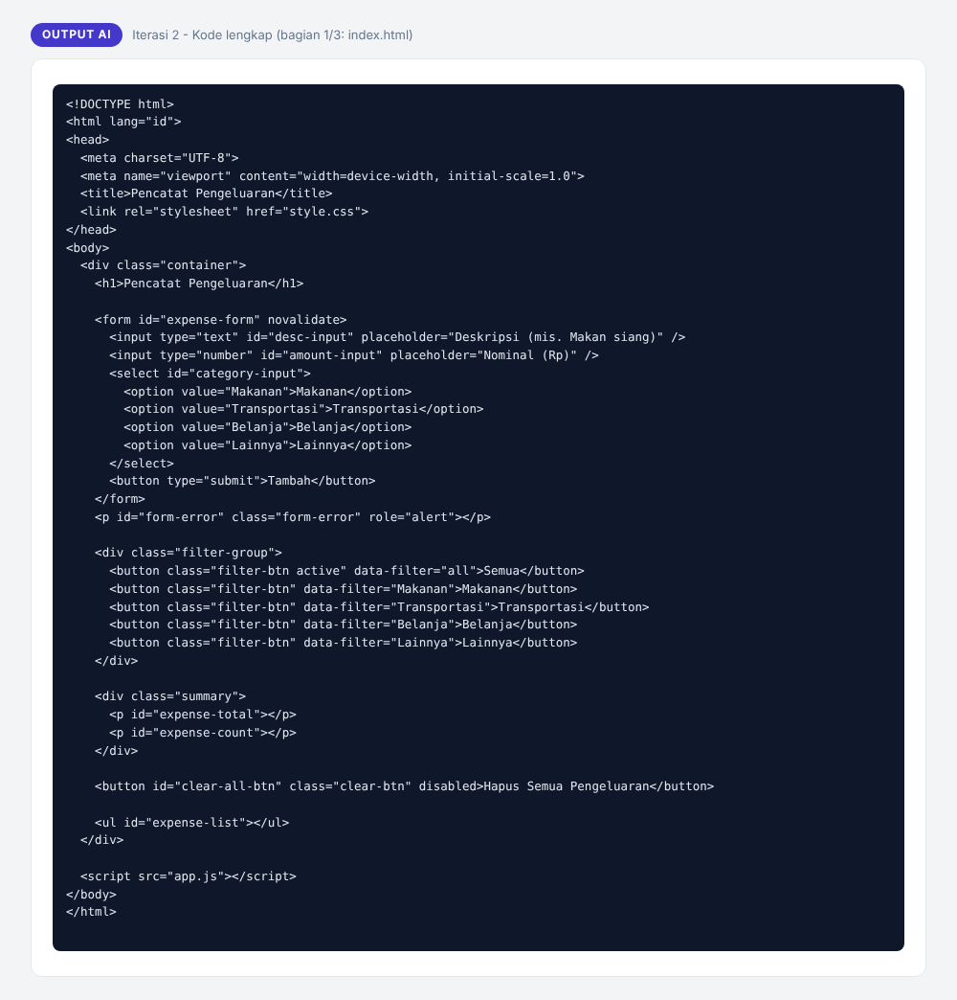

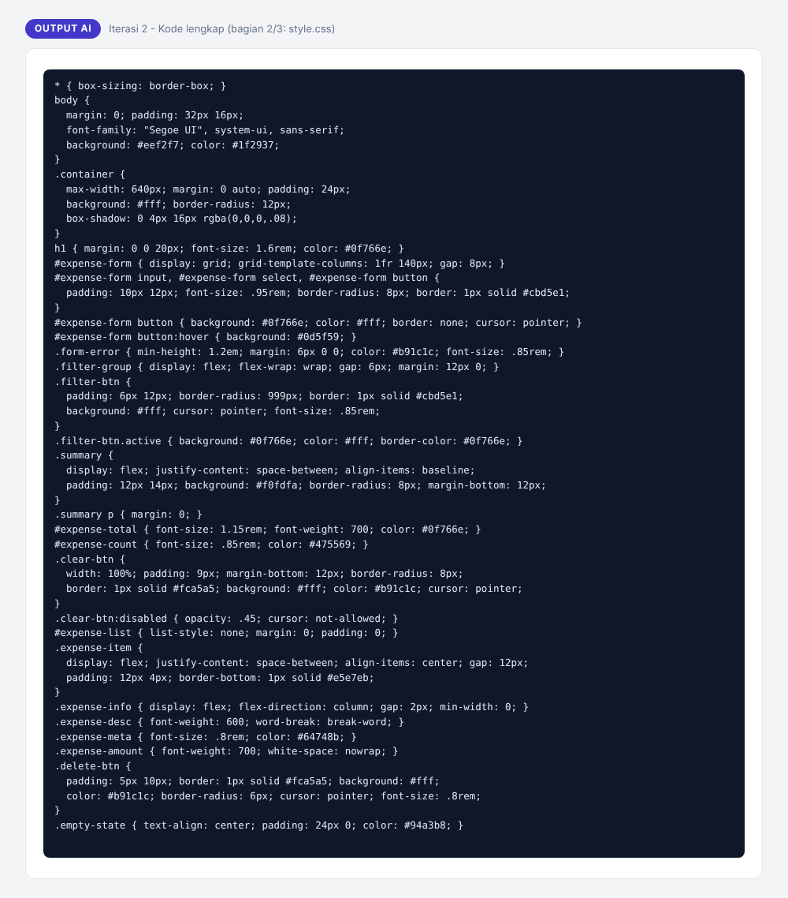

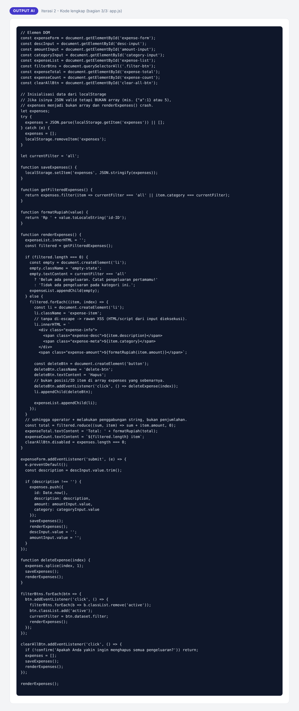

**Evaluasi.** Struktur dan fitur sesuai permintaan, dan aplikasi langsung berjalan pada skenario normal (menambah, memfilter, menghapus). AI menyertakan `try/catch` pada pembacaan `localStorage` dan komentar yang jelas. Namun, ketika diuji dengan masukan yang tidak ideal, ditemukan empat masalah yang dibahas di Bab 3.4: nilai nominal diperlakukan sebagai *string*, penghapusan memakai indeks daftar terfilter, deskripsi disisipkan lewat `innerHTML`, dan pemeriksaan data `localStorage` hanya mencakup sintaks JSON.

**Keputusan.** Kode dijalankan apa adanya terlebih dahulu sebagai **versi berbug** (`app.buggy.js`) untuk mendokumentasikan kondisi *sebelum* perbaikan, kemudian bug dikirim kembali ke AI pada Iterasi 3.

## 3.3 Iterasi 3 — Perbaikan Bug

Prompt ketiga menjelaskan keempat bug beserta gejalanya, dan meminta AI memberikan **perbaikan dalam bentuk diff saja** (bukan file utuh), tanpa mengubah struktur file dan fitur lain, disertai penjelasan penyebab tiap bug.

- `screenshots/prompts/07-iterasi3-prompt.png` — prompt iterasi ketiga
- `screenshots/prompts/08-iterasi3-output.png` dan `09-iterasi3-output.png` — output AI (dua bagian)

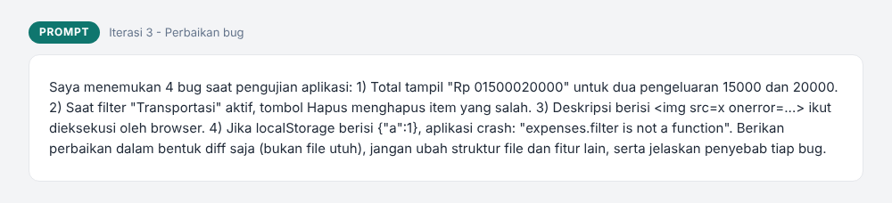

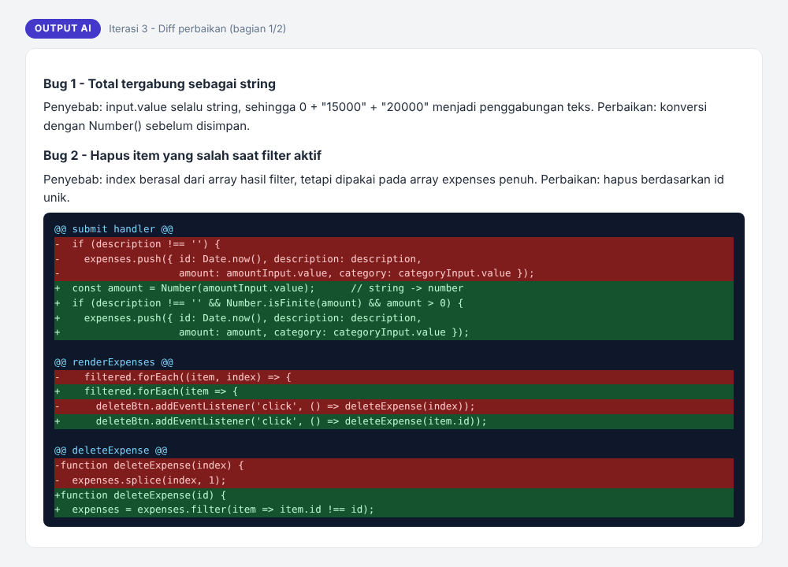

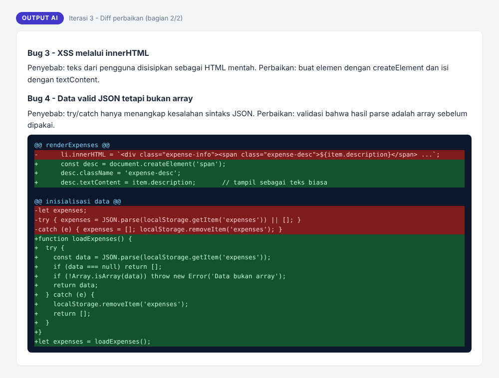

**Evaluasi.** AI mengikuti instruksi eksplisit: mengirim diff (bukan file utuh), menjelaskan penyebab, dan keempat perbaikannya benar secara teknis. Namun ada beberapa kekurangan: (1) validasi nominal menolak input salah tanpa memberi tahu pengguna; (2) pesan konfirmasi hapus-semua masih generik tanpa jumlah dan total; (3) pemeriksaan array belum memeriksa bentuk tiap item; (4) ID masih memakai `Date.now()` yang berisiko duplikat.

**Keputusan.** Diff AI diadopsi, lalu disempurnakan secara manual (lihat Bab 3.5) dan hasilnya menjadi `app.js` versi final.

## 3.4 Contoh Evaluasi Kritis — Empat Bug dan Perbaikannya

Semua bug dibuat dapat direproduksi dengan membuka `index-buggy.html`, dan semuanya didokumentasikan dengan screenshot kondisi *sebelum* dan *sesudah* perbaikan.

### Bug #1 — Total pengeluaran tergabung sebagai string

**Gejala.** Setelah menambahkan dua pengeluaran (Rp 15.000 dan Rp 20.000), total tampil sebagai `Rp 01500020000`, bukan `Rp 35.000`. Nominal item pun tampil tanpa pemisah ribuan (`Rp 15000`).

**Penyebab.** Nilai `amountInput.value` selalu bertipe *string*, dan nilai itu disimpan apa adanya. Pada `reduce`, ekspresi `sum + item.amount` dengan salah satu operand *string* menjadi **penggabungan teks**: `0 + "15000"` menghasilkan `"015000"`, lalu `+ "20000"` menghasilkan `"01500020000"`.

**Kode berbug:**

```javascript
expenses.push({
  id: Date.now(),
  description: description,
  amount: amountInput.value,          // string!
  category: categoryInput.value
});
// ...
const total = filtered.reduce((sum, item) => sum + item.amount, 0);
```

**Perbaikan.** Konversi eksplisit ke `Number` dan validasi sebelum disimpan:

```javascript
const amount = Number(amountInput.value);
if (amountInput.value.trim() === '' || !Number.isFinite(amount) || amount <= 0) {
  showError('Nominal harus berupa angka lebih dari 0.');
  return;
}
expenses.push({ id: createId(), description, amount, category: categoryInput.value });
```

**Bukti.** `screenshots/bugs/bug-01-total-string.png` (sebelum) dan `fix-01-total-string.png` (sesudah).

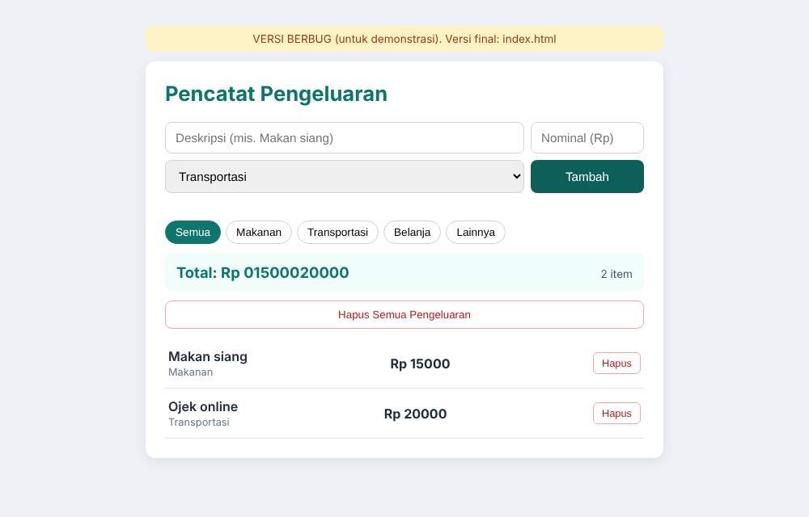

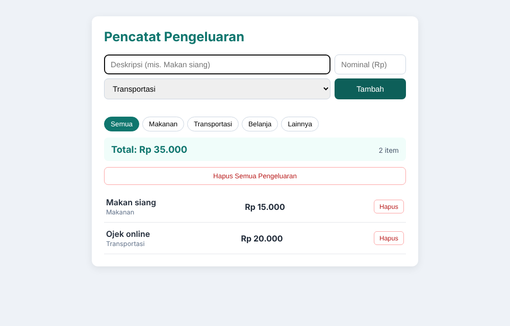

**Alasan keputusan.** Nilai dari elemen `<input>` selalu *string*, bahkan untuk `type="number"`. Konversi tipe harus dilakukan di titik masuk data (saat disimpan), bukan saat dihitung, agar seluruh bagian aplikasi bekerja dengan tipe yang benar.

### Bug #2 — Tombol Hapus menghapus item yang salah saat filter aktif

**Gejala.** Pada daftar berisi *Makan siang* (Makanan), *Ojek online* (Transportasi), dan *Sepatu* (Belanja), filter Transportasi diaktifkan lalu tombol Hapus pada *Ojek online* diklik. Setelah kembali ke filter Semua, yang hilang adalah *Makan siang*, sedangkan *Ojek online* masih ada.

**Penyebab.** Tombol hapus menerima `index` dari `filtered.forEach((item, index) => ...)`, yaitu posisi item **dalam daftar hasil filter** (indeks 0). Namun `expenses.splice(index, 1)` bekerja pada **array penuh**, sehingga item pertama pada array penuh (*Makan siang*) yang terhapus.

**Kode berbug:**

```javascript
filtered.forEach((item, index) => {
  // ...
  deleteBtn.addEventListener('click', () => deleteExpense(index));
});

function deleteExpense(index) {
  expenses.splice(index, 1);
  saveExpenses();
  renderExpenses();
}
```

**Perbaikan.** Identifikasi item dengan ID unik, bukan posisi:

```javascript
deleteBtn.addEventListener('click', () => deleteExpense(item.id));

function deleteExpense(id) {
  expenses = expenses.filter(item => item.id !== id);
  saveExpenses();
  renderExpenses();
}
```

**Bukti.** `screenshots/bugs/bug-02-delete-filter.png` (sebelum) dan `fix-02-delete-filter.png` (sesudah).

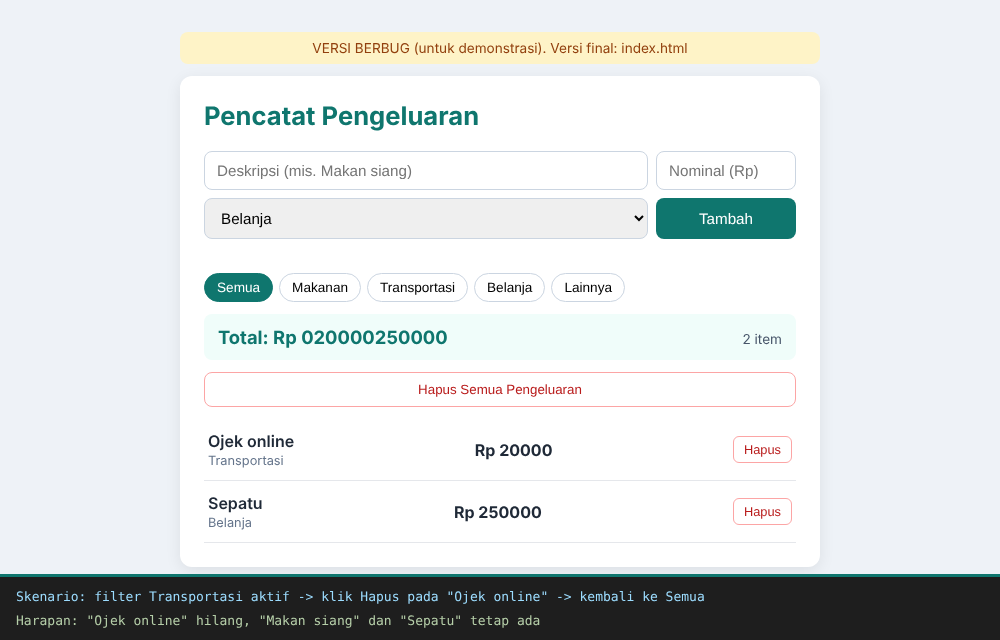

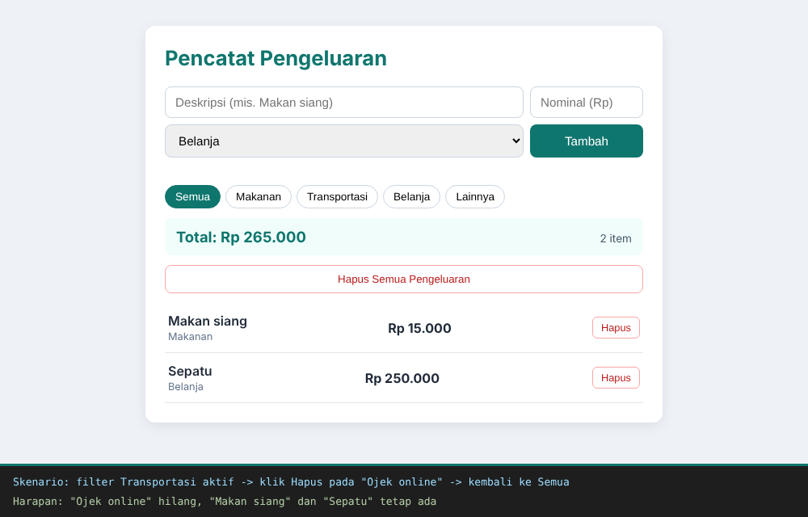

**Alasan keputusan.** Bug ini tidak muncul selama filter "Semua" aktif (indeks daftar terfilter sama dengan indeks array), sehingga lolos dari pengujian sekilas. Memakai ID unik membuat operasi hapus tidak bergantung pada urutan atau filter.

### Bug #3 — XSS melalui `innerHTML`

**Gejala.** Ketika deskripsi diisi `Kopi`, browser tidak menampilkannya sebagai teks, melainkan mengeksekusi kode pada atribut `onerror`. Pada demonstrasi ini kodenya mengganti elemen dengan teks merah *[SCRIPT DIJALANKAN - XSS]*; pada serangan sungguhan, kode yang sama dapat mencuri atau mengubah data.

**Penyebab.** Deskripsi dari pengguna disisipkan menggunakan *template string* ke `li.innerHTML`, sehingga diperlakukan sebagai HTML mentah.

**Kode berbug:**

```javascript
li.innerHTML = `
  <div class="expense-info">
    <span class="expense-desc">${item.description}</span>
    <span class="expense-meta">${item.category}</span>
  </div>
  <span class="expense-amount">${formatRupiah(item.amount)}</span>`;
```

**Perbaikan.** Bangun elemen dengan `createElement` dan isi dengan `textContent`:

```javascript
const desc = document.createElement('span');
desc.className = 'expense-desc';
desc.textContent = item.description;   // selalu dianggap teks biasa
```

**Bukti.** `screenshots/bugs/bug-03-xss.png` (sebelum) dan `fix-03-xss.png` (sesudah).

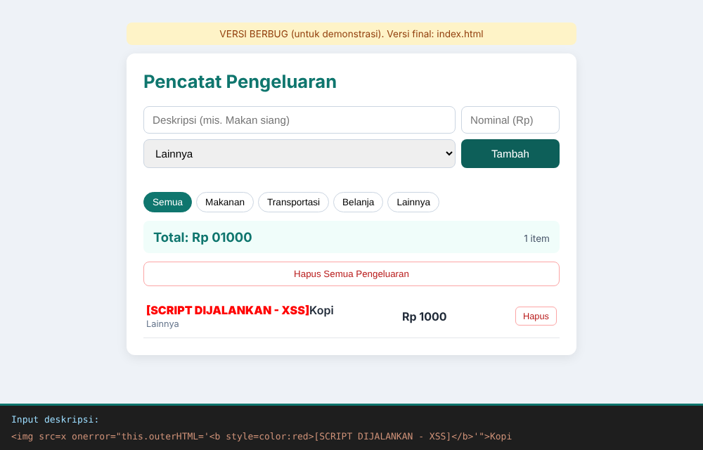

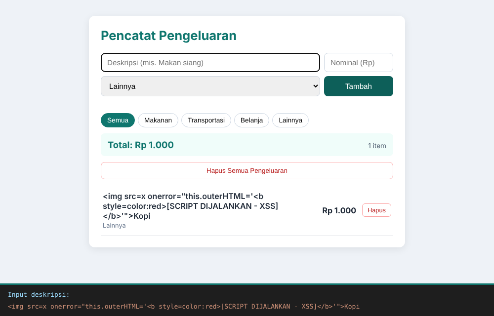

**Alasan keputusan.** Data di `localStorage` dan data dari form harus dianggap tidak tepercaya. `textContent` menutup celah ini di sumbernya tanpa perlu menulis fungsi *escape* sendiri.

### Bug #4 — `try/catch` tidak cukup untuk data valid JSON yang bentuknya salah

**Gejala.** Setelah `localStorage.setItem('expenses', '{"a":1}')` dijalankan di console lalu halaman di-refresh, muncul `Uncaught TypeError: expenses.filter is not a function`. Daftar tidak tampil, total kosong, dan aplikasi tidak dapat dipakai.

**Penyebab.** Kode sudah memakai `try/catch`, sehingga data berformat `data-rusak` (bukan JSON) tertangani. Namun `{"a":1}` adalah JSON yang **valid**, sehingga `JSON.parse` tidak melempar error dan `expenses` berisi objek, bukan array. Error baru muncul saat `expenses.filter(...)` dipanggil pada `renderExpenses()`.

**Kode berbug:**

```javascript
let expenses;
try {
  expenses = JSON.parse(localStorage.getItem('expenses')) || [];
} catch (e) {
  expenses = [];
  localStorage.removeItem('expenses');
}
```

**Perbaikan.** Validasi bentuk data, bukan hanya sintaks JSON:

```javascript
function loadExpenses() {
  try {
    const raw = localStorage.getItem(STORAGE_KEY);
    if (raw === null) return [];
    const data = JSON.parse(raw);
    if (!Array.isArray(data)) throw new Error('Data bukan array');
    return data.filter(isValidExpense);   // buang item yang bentuknya salah
  } catch (e) {
    localStorage.removeItem(STORAGE_KEY);
    return [];
  }
}
let expenses = loadExpenses();
```

**Bukti.** `screenshots/bugs/bug-04-shape.png` (sebelum) dan `fix-04-shape.png` (sesudah).

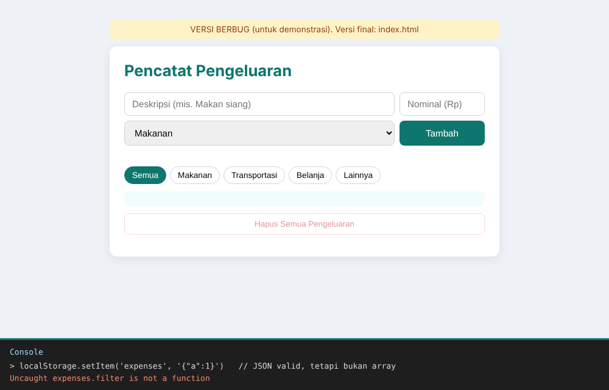

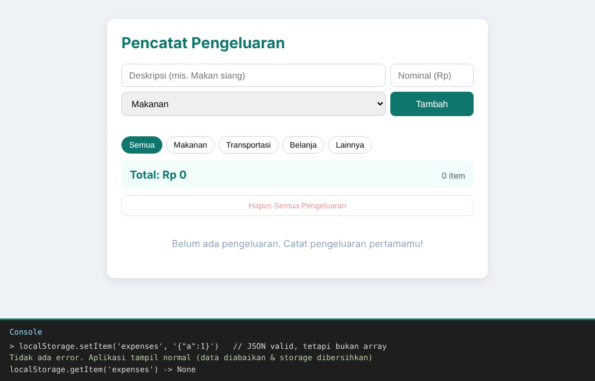

**Alasan keputusan.** Data `localStorage` dapat berubah karena ekstensi browser, skema data versi lama, atau diedit manual. Penanganan yang benar memeriksa *tipe dan bentuk* data, sehingga aplikasi tidak pernah menampilkan layar rusak tanpa penjelasan.

### Ringkasan Bug

| **#** | **Bug** | **Jenis** | **Sumber** | **Perbaikan** |
|---|---|---|---|---|
| 1 | Total tergabung sebagai string | Kesalahan tipe data | Output AI | `Number()` + validasi nominal |
| 2 | Hapus item yang salah saat filter | Kesalahan logika | Output AI | Hapus berdasarkan ID |
| 3 | XSS lewat `innerHTML` | Keamanan | Output AI | `createElement` + `textContent` |
| 4 | Data bentuk salah membuat crash | Penanganan *edge case* | Output AI | Validasi `Array.isArray` + item |

## 3.5 Keputusan yang Diambil di Luar AI

Beberapa keputusan tidak diambil dari output AI, melainkan dari evaluasi mandiri:

1. **Penolakan saran AI** untuk menggunakan framework, grafik, anggaran bulanan, dan ekspor CSV pada Iterasi 1 — di luar ruang lingkup tugas.
2. **Pesan kesalahan form** (“Nominal harus berupa angka lebih dari 0.”) — AI hanya menolak input tanpa memberi tahu pengguna.
3. **Konfirmasi hapus-semua yang informatif** (“Hapus 3 pengeluaran (total Rp 88.000)?”) — AI hanya memberi pesan generik tanpa jumlah dan total.
4. **Validasi tiap item** saat membaca `localStorage` (`isValidExpense`) — melampaui perbaikan AI yang hanya memeriksa array.
5. **ID unik yang lebih aman** (`Date.now()` digabung angka acak) — mencegah duplikat pada penambahan dalam milidetik yang sama.
6. **Mempertahankan versi berbug di repositori** (`app.buggy.js`, `index-buggy.html`) — agar bug dapat direproduksi oleh penilai.

# 4. Pengujian

## 4.1 Metode

Pengujian dilakukan secara **manual end-to-end** di browser (Chromium) pada versi final (`index.html`), mencakup 8 skenario fungsional dan 1 skenario kondisi tepi (validasi input). Setiap rangkaian skenario dijalankan dari *state* bersih (`localStorage.clear()` sebelum mulai) untuk memastikan hasil tidak dipengaruhi sisa data. Screenshot diambil otomatis menggunakan Playwright agar kondisi yang ditampilkan konsisten dan dapat diulang.

## 4.2 Hasil

| **#** | **Skenario** | **Hasil** | **Bukti** |
|---|---|---|---|
| 1 | Buka aplikasi dengan data kosong | Empty state tampil, total "Rp 0", tombol hapus-semua *disabled* | `testing/01-empty-state.png` |
| 2 | Tambah pengeluaran "Makan siang" Rp 25.000 | Item muncul, total "Rp 25.000", 1 item | `testing/02-tambah-pengeluaran.png` |
| 3 | Tambah beberapa item lagi | Total dijumlahkan sebagai angka: Rp 96.000 | `testing/03-total-banyak-item.png` |
| 4 | Klik filter Makanan | Hanya item Makanan tampil, total mengikuti filter | `testing/04-filter-kategori.png` |
| 5 | Hapus item saat filter Transportasi aktif | Hanya item yang dimaksud terhapus | `testing/05-hapus-saat-filter.png` |
| 6 | Refresh halaman (F5) | Data tetap sama | `testing/06-persist-refresh.png` |
| 7 | Hapus semua pengeluaran | Seluruh item hilang, total dan tombol diperbarui | `testing/07a-hapus-semua-before.png`, `07b-hapus-semua-after.png` |
| 8 | Simulasi data `localStorage` korup (`data-rusak`) | Aplikasi tidak crash, daftar kosong, data rusak dibersihkan | `testing/08a-data-korup-before.png`, `08b-data-korup-after.png` |
| 9 | Isi nominal negatif (-5000) | Ditolak dengan pesan kesalahan | `testing/09-validasi-nominal.png` |


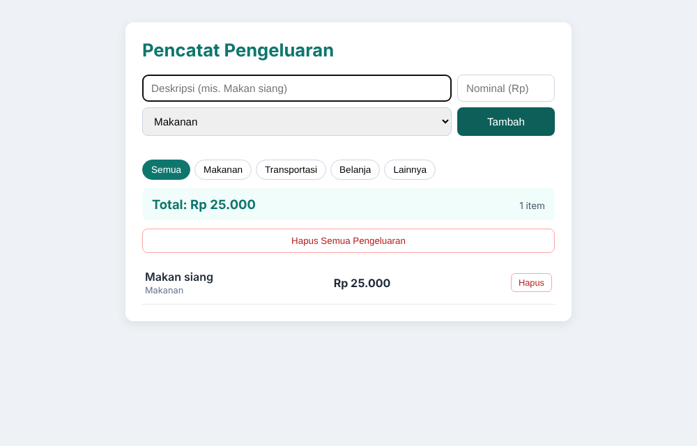

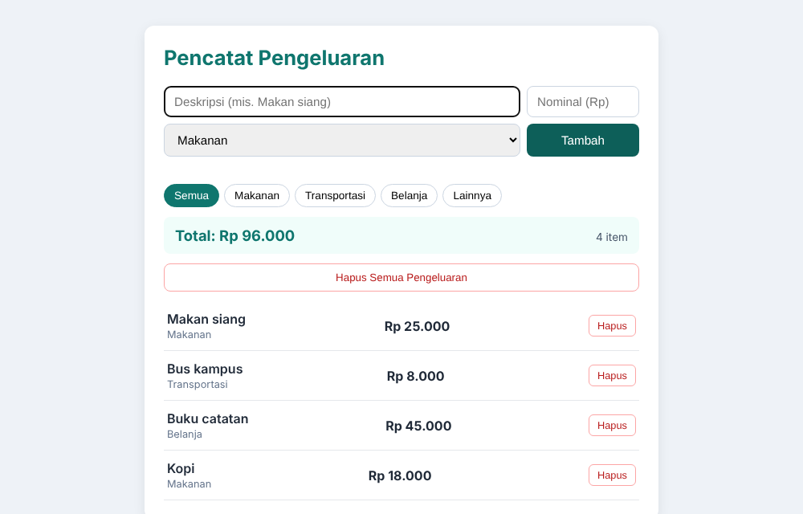

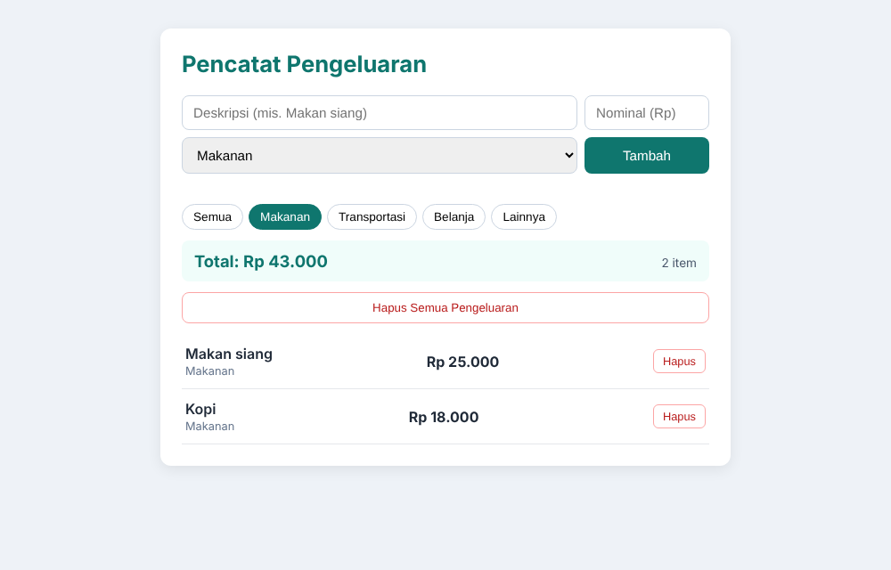

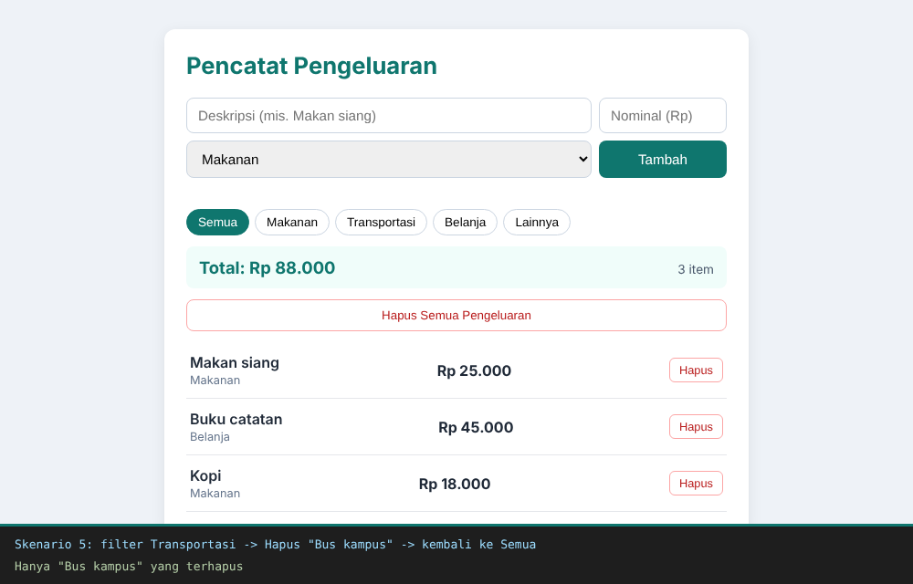

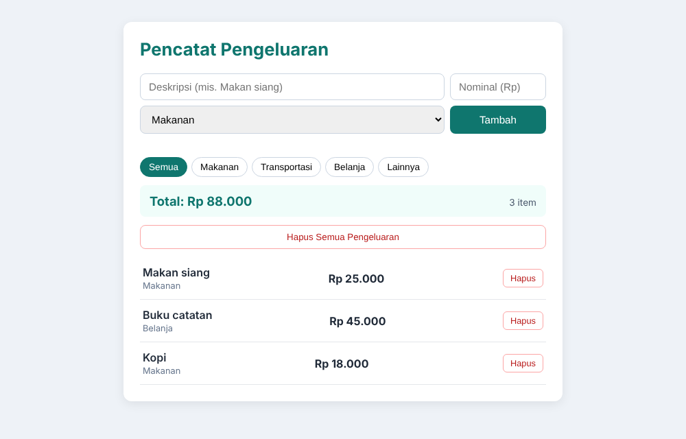


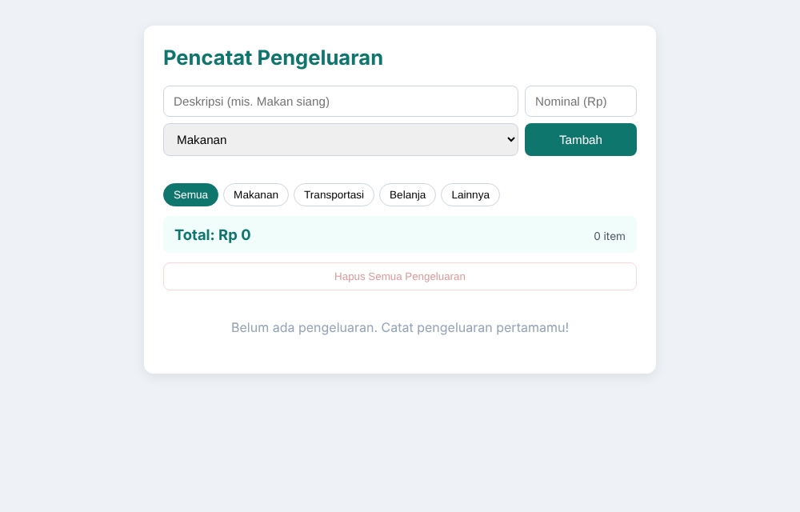


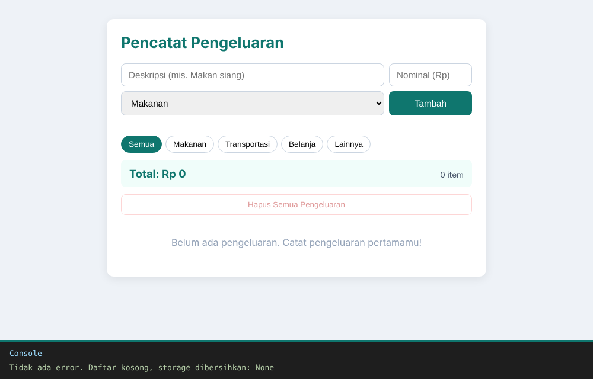

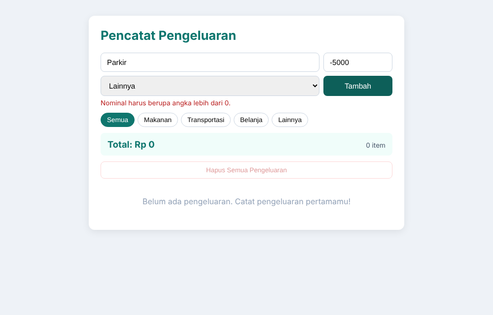

Seluruh skenario **lolos** sesuai harapan. Dokumentasi visual lengkap tersimpan di folder `screenshots/testing/`.

## 4.3 Kesimpulan Pengujian

Aplikasi versi final berjalan sesuai kebutuhan fungsional seluruh fitur wajib, tahan terhadap data `localStorage` yang korup (baik sintaks maupun bentuk), aman terhadap penyisipan HTML dari input, dan seluruh bagian UI (total, jumlah item, tombol, empty state) tersinkronisasi dengan *state* data. Keempat skenario bug yang sama dijalankan ulang pada versi final dan **tidak ada yang muncul kembali**.

# 5. Kesimpulan

## 5.1 Ringkasan

Aplikasi web Pencatat Pengeluaran sederhana berhasil dikembangkan menggunakan HTML, CSS, dan JavaScript vanilla dengan bantuan Generative AI pada tahap rancangan, implementasi, dan perbaikan. Kode hasil AI pada Iterasi 2 berjalan baik pada skenario normal, tetapi mengandung empat bug yang baru terlihat saat diuji dengan kondisi tepi: kesalahan tipe data pada angka, kesalahan logika penghapusan saat filter aktif, celah XSS, dan validasi data penyimpanan yang tidak lengkap. Semua bug berhasil diidentifikasi, diperbaiki, dan didokumentasikan dengan bukti screenshot serta potongan kode sebelum dan sesudah.

## 5.2 Refleksi Penggunaan AI

Pengalaman ini memberikan empat pelajaran utama:

1. **Kode AI yang “jalan” belum tentu benar.** Iterasi 2 menghasilkan aplikasi yang tampak lengkap, tetapi seluruh bug muncul justru pada skenario di luar alur normal. Pengujian kondisi tepi tidak boleh dilewati.
2. **AI cenderung mengabaikan aspek keamanan dan tipe data kecuali diminta.** `innerHTML` dengan input pengguna dan `input.value` yang tidak dikonversi adalah kesalahan klasik yang perlu dikenali pengembang.
3. **AI menjalankan instruksi teknis dengan baik, tetapi kurang peka terhadap UX.** Perbaikan pada Iterasi 3 benar secara teknis, tetapi tidak memberi umpan balik kepada pengguna saat input ditolak dan pesan konfirmasi tetap generik.
4. **Prompt perbaikan yang spesifik menghasilkan jawaban yang lebih baik.** Menyertakan gejala, langkah reproduksi, dan batasan (“diff saja, jangan ubah fitur lain”) membuat output AI singkat, tepat sasaran, dan mudah diverifikasi.

## 5.3 Saran Pengembangan

- **Fitur edit pengeluaran** agar data dapat dikoreksi tanpa menghapus.
- **Filter rentang tanggal** dan penambahan kolom tanggal pada tiap pengeluaran.
- **Ringkasan per kategori** (grafik batang sederhana) bila kebutuhan bertambah.
- **Ekspor data ke CSV** untuk pelaporan.
- ***Automated testing*** (Jest, Vitest, atau Playwright) agar bug yang sudah diperbaiki tidak muncul kembali.

# Lampiran {.unnumbered}

- **prompt-log.md** — log lengkap prompt, output AI, evaluasi, bug, dan perbaikan.
- **screenshots/prompts/** — dokumentasi visual prompt dan output AI (Iterasi 1–3, total 9 gambar).
- **screenshots/bugs/** — bukti kondisi bug sebelum dan sesudah perbaikan (4 bug, 8 gambar).
- **screenshots/testing/** — hasil uji end-to-end 9 skenario (11 gambar).
- **app.buggy.js** dan **index-buggy.html** — versi berbug untuk reproduksi.
- **README.md** — deskripsi singkat repositori.
